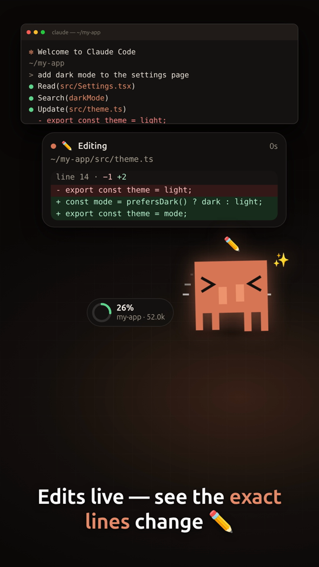

# Buddy HUD

A floating pixel buddy for [Claude Code](https://claude.com/claude-code). It sits on top of your windows and acts out what Claude is doing, so you can see it without watching the terminal.

> Unofficial community project. Not affiliated with or endorsed by Anthropic.



[Watch the 40-second demo](docs/demo.mp4)

## What it does

- **The buddy reacts to the work.** Typing hands for edits and commands, eyes sweeping for reads, a swinging magnifier for searches, a hand on the head while thinking, a wave when Claude needs you, asleep when idle.
- **Live diffs.** See the file, the line number and the exact lines Claude is changing.
- **File counts.** The pill beside the buddy always shows unique files read and edited plus commands run. Open details for the file lists.
- **Model switcher + theme.** Click the buddy to pick Fable, Opus, Sonnet or Haiku. The buddy and the whole UI change colour to match the model in use (purple Opus, orange Sonnet, teal Haiku, magenta Fable).
- **Context window.** A ring shows how full the context is.
- **Readable replies.** Claude's last message renders as formatted text (bold, code, lists), not raw markdown.
- **Privacy mode.** One toggle blurs paths, code and conversation, handy for screen sharing and streaming.
- **Permissions.** Allow, Deny or "ask in terminal" from the overlay, with a desktop notification.
- **Replies.** When Claude stops, its last message appears in a bubble. Type back from the overlay (see [Replying](#replying)).
- **Multiple sessions.** One tab per Claude Code session.

Click the buddy for history and settings. Drag it anywhere.

## Install

Download the installer for your system from the Releases page:

| OS | File |
|---|---|
| Linux | `.AppImage` or `.deb` |
| macOS | `.dmg` |
| Windows | `.exe` installer or portable |

On first launch Buddy HUD asks to add its hooks to `~/.claude/settings.json` (a backup is saved as `settings.json.bak-buddy-hud`) and to start at login. Both are in the tray menu later.

### From source

```bash
git clone https://github.com/OWNER/buddy-hud && cd buddy-hud
npm install
npm start          # run the app
npm run hooks      # add the Claude Code hooks (npm run hooks:remove to undo)
```

Then restart any running Claude Code session.

## Switching models

Click the buddy, pick a family (Fable, Opus, Sonnet, Haiku), then any version Claude Code offers (for example Opus 5.5 down to 4, Sonnet 5.5 to 4, with optional 1M-context variants). Availability depends on your plan. Claude Code has no external API for changing a running session's model, so Buddy HUD uses its `/model` command: inside tmux and idle it types the command for you, otherwise it copies it to your clipboard to paste. The buddy changes colour straight away and confirms once Claude's next reply reports the new model.

## How it works

Claude Code [hooks](https://docs.claude.com/en/docs/claude-code/hooks) POST each event (tool use, prompt, stop, permission request) with `curl` to a server on `127.0.0.1:47800`. The Electron app turns those events into animation, diffs and bubbles. Nothing leaves your machine. The hooks need only `curl`, which ships with macOS, Linux and Windows 10+.

## Replying

- **Claude is working:** your message is queued and handed to Claude at its next step.
- **Claude is idle, inside tmux:** the text is typed straight into the pane.
- **Claude is idle, elsewhere:** the message is queued until Claude's next step. Start the next turn in the terminal.
- **Experimental:** turn on "hold turn-end" in settings and the Stop hook waits for your reply. The terminal then shows "hook running" until you answer or press skip.

## Platform notes

- **Linux:** runs through XWayland so it can stay on top under Wayland. Tested on Ubuntu 26.04 / GNOME.
- **macOS and Windows:** the code paths exist (tray, always-on-top, login item, packaging) but have **not been tested on real machines yet**. Please open an issue with what you see.
- On Windows, hooks run in the shell Claude Code uses. Git Bash is the best-supported setup because the hook reads `$TMUX`.

## Privacy and security

- Everything stays on your machine. The app listens only on `127.0.0.1:47800` and sends nothing to any server.
- It reads the conversation transcript Claude Code already writes locally, only to show context use and Claude's last message.
- The server rejects requests that carry a browser `Origin` header, so web pages cannot talk to it.
- Allow/Deny works because the hook waits for your click; if the app is closed, Claude Code falls back to its normal prompt.
- Turn on privacy mode in settings before screen sharing.

## Troubleshooting

| Symptom | Fix |
|---|---|
| Nothing appears | Start a new `claude` session (existing ones keep the old hook config). Check the tray menu: "Install Claude Code hooks". |
| "Port 47800 is already in use" | Another copy is running. Quit it from its tray icon. |
| Buddy is not on top (Linux) | Needs X11 or XWayland. The app relaunches itself with `--ozone-platform=x11`. |
| Terminal shows "hook running" | You enabled "Hold turn-end for replies". Turn it off in settings. |
| Model switch did nothing | Outside tmux it copies `/model …` to the clipboard. Paste it into Claude Code. |

## Uninstall

Tray menu, "Remove Claude Code hooks", then quit and delete the app. Settings live in `~/.buddy-hud/`.

## Development

```bash
npm start            # run
npm run dist         # build installers for the current OS
npm test             # hook installer tests (uses a temp HOME)
npm run promo        # re-record the demo video (needs ffmpeg)
```

Layout: `main.js` (server, window, tray), `renderer/` (mascot SVG, CSS animations, UI), `install-hooks.js`, `promo/` (deterministic video recorder).

## License

MIT. The pixel mascot is a fan homage to the Claude Code logo; if Anthropic asks, it will be replaced.
